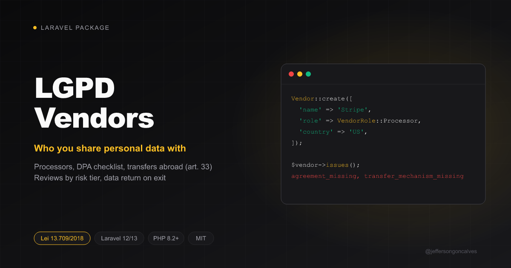

# Laravel LGPD Vendors



[](https://packagist.org/packages/jeffersongoncalves/laravel-lgpd-vendors)
[](https://github.com/jeffersongoncalves/laravel-lgpd-vendors/actions/workflows/tests.yml)
[](https://packagist.org/packages/jeffersongoncalves/laravel-lgpd-vendors)

A register of the third parties you share personal data with, for the Brazilian General Data Protection Law (LGPD, Lei 13.709/2018). It is part of the [laravel-lgpd](https://github.com/jeffersongoncalves/laravel-lgpd) suite.

The controller stays responsible for what its processors (*operadores*) do with the data (arts. 39 and 42). For each vendor you record:

- its **role**: processor, independent controller or joint controller;
- a **risk tier**, which sets how often the vendor must be reviewed;
- the **data processing agreement** (DPA): when it was signed and when it expires, plus a checklist of what it must cover;
- where the vendor is, and the **international transfer mechanism** (art. 33) when it is abroad;
- when the relationship **ended**, and whether the data was deleted or returned (art. 16).

Each vendor then tells you what it still owes.

> This package gives you tooling. It does not make you compliant on its own. Your agreements need legal review.

## Installation

```bash
composer require jeffersongoncalves/laravel-lgpd-vendors
php artisan vendor:publish --tag="lgpd-vendors-migrations"
php artisan migrate
php artisan vendor:publish --tag="lgpd-vendors-config"   # optional: checklist, review intervals, home country
```

## Usage

```php
use JeffersonGoncalves\LgpdVendors\Enums\{TransferMechanism, VendorRisk, VendorRole};
use JeffersonGoncalves\LgpdVendors\Models\Vendor;

$stripe = Vendor::create([
    'name' => 'Stripe',
    'role' => VendorRole::Processor,
    'services' => 'Card payments',
    'data_categories' => ['name', 'email', 'card data'],
    'country' => 'US',
    'transfer_mechanism' => TransferMechanism::StandardClauses,
    'risk' => VendorRisk::High,
    'dpa_signed_at' => '2026-01-10',
    'dpa_checklist' => ['instructions' => true, 'security_measures' => true /* ... */],
]);

$stripe->issues();           // [VendorIssue::AgreementIncomplete, ...]
$stripe->missingChecklistItems(); // ['sub_processors', 'audits', ...]
$stripe->nextReviewAt();     // reviewed_at (or created_at) + review_every[risk]
$stripe->markReviewed();

$stripe->terminate();        // contract ended
$stripe->confirmDataReturned();
```

### Issues

| Issue | When |
|---|---|
| `agreement_missing` | a processor or joint controller has no signed DPA |
| `agreement_expired` | `dpa_expires_at` has passed |
| `agreement_incomplete` | the DPA misses an item of `dpa_checklist` |
| `transfer_mechanism_missing` | `country` is not your `home_country` and there is no `transfer_mechanism` |
| `review_due` | the last review is older than `review_every` for its risk tier (high: 1 year, medium: 2, low: 3) |
| `data_return_pending` | the vendor was terminated and the data deletion or return is not confirmed |

An independent controller (a tax authority, a bank that receives a payment) needs no DPA. After `terminate()`, only `data_return_pending` applies. The `active` scope skips terminated vendors.

The default DPA checklist covers documented instructions, confidentiality, security measures, sub-processors, help with data subject requests, incident notification, international transfers, deletion at the end of the contract and audits. Change it in `config/lgpd-vendors.php`.

### Transfer mechanisms

`TransferMechanism` mirrors art. 33: `adequacy`, `specific_clauses`, `standard_clauses` (Res. CD/ANPD 19/2024), `binding_corporate_rules`, `seals_certificates`, `international_cooperation`, `life_protection`, `anpd_authorization`, `international_commitment`, `public_policy`, `specific_consent` and `legal_basis`.

## Report

```bash
php artisan lgpd:vendors             # every vendor, its next review and its issues
php artisan lgpd:vendors --issues    # only those with issues
php artisan lgpd:vendors --json
```

## Testing

```bash
composer test
```

## Changelog

See [CHANGELOG](CHANGELOG.md).

## License

The MIT License (MIT). See [License File](LICENSE.md).
